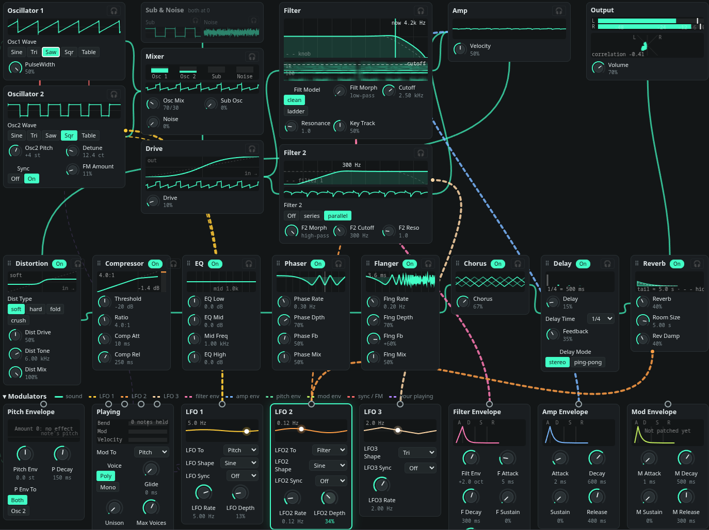

# Synth Playground



[Live Demo](https://synth.ulus.uk/)

A synth in the browser for learning synthesis by playing.

The Synth view draws the whole synth as blocks in signal order, with cables that show what modulates what.
Every block shows its live signal, and you can listen to the sound at any point.

It works with the mouse and the computer keyboard (A row plays notes, Z/X change octave). An Arturia MiniLab 3
is optional: connected, every control on the device does something, and the app drives its pad lights and screen.

## Features

- Two oscillators with sine, triangle, saw, square and wavetable waves, plus pulse width, hard sync and FM.
- Two filters: a clean state-variable filter and a Moog-style ladder, with a low-pass to high-pass morph.
  Filter 2 runs in series or in parallel.
- Four envelopes, three LFOs and a mod matrix with 8 routes. Patch by dragging cables in the Synth view.
- Eight effects: distortion, compressor, EQ, phaser, flanger, chorus, delay and reverb. Drag them to change the order.
- A drum kit with a 16-step loop and a step sequencer.
- A Song view: a drum track and up to seven synth tracks, each with its own sound, a mixer (volume, pan, mute, solo), and clips that loop on each track (sent from the Play view's drum loop and step sequencer, or written in a piano roll), and recording into clips from the keys, the MiniLab, the arpeggiator or the pads, with a count-in and a metronome), and an arrangement: clips placed on a timeline in bars, linked so a change to a clip is heard everywhere, with a loop region.
- A Wavetable view in 3D. Import your own sound (WAV, MP3, OGG…) as a wavetable.
- A course and recipes that teach synthesis step by step.
- Factory presets, including 21 recreations of famous synth sounds (TB-303, Prophet-5, Juno, CS-80…).
  Save your own presets in the browser.
- A random patch button (Dice) and undo.
- Clean sound: anti-aliased oscillators and drive, and each voice runs at twice the sample rate.

## Run it

```sh
bun install
bun run dev        # http://localhost:5173
bun run typecheck
bun test
```

Use a Chromium browser (Chrome, Brave, Edge, Helium). Firefox and Safari lack full Web MIDI with SysEx.
For the pad lights and the screen, put the MiniLab in DAW mode (Shift + Prog).

## Project Structure

- `src/audio/`: the audio engine. Every note is made in one AudioWorklet (`synth.worklet.ts`); the DSP is
  plain TypeScript in `dsp/`.
- `src/app/`: the Svelte UI.
- `src/presets/`: factory presets.
- `src/minilab/`: the MiniLab 3 protocol. See `docs/minilab3-protocol.md`.
- `src/probe/`: a raw MIDI probe page (`/probe.html`).
